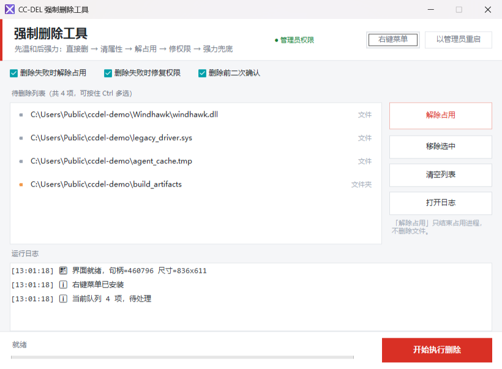

<p align="center">
  
</p>

<h1 align="center">CC-DEL</h1>

<p align="center">
  <strong>Windows10/11 强制删除工具 · 单文件 · 免安装</strong>
  ，使用AI 生成的 PowerShell + WinForms脚本文件，然后用GO打包成exe文件，其实直接使用ps1的文件就行才几十KB。
</p>
<br>
<p align="center">
  先把占用者找出来，再动手删。<br>
  删不掉的文件，九成不是「没有权限」，<br>
  而是「有人正拿着它」——或者它的名字根本不合法。
</p>

<p align="center">
  <sub>Windows 10 / 11 · 64 位 · 仅依赖系统自带组件</sub>
</p>

<p align="center">
  <a href="https://github.com/pcoof/CC-DEL/actions/workflows/build.yml"></a>
  <a href="https://github.com/pcoof/CC-DEL/releases"></a>
  <a href="LICENSE"></a>
</p>

<p align="center">
  
</p>

---

## 这东西解决什么

资源管理器说「文件正在使用中」，你打开任务管理器翻了一圈，也不知道是谁在用。
更烦的是结束了进程、改了权限、清了只读，它还是一句 `拒绝访问`。

CC-DEL 把这件事拆成两条线索：

| 线索 | 现象 | 处理方式 |
| --- | --- | --- |
| **句柄占用** | 进程开着这个文件的句柄 | 结束进程，句柄随之释放，立刻能删 |
| **映像锁定** | DLL 被加载进了进程，**没有句柄** | 结束进程也未必释放，通常只能等重启 |

第二条是关键。被 `LoadLibrary` 加载的 DLL 不持有文件句柄，所以任务管理器、`handle.exe`、
甚至系统自带的 Restart Manager 都查不到它——但文件照样删不掉。
CC-DEL 会遍历所有进程的**模块列表**，把「谁把它加载进去了」直接点出来。

## 功能

- **渐进式删除**，只在前一步失败时才动下一步，绝不无脑改权限：
  1. 直接删（`.NET` / Win32）
  2. 清属性（只读 / 隐藏 / 系统）
  3. 解除占用（Restart Manager → 逐个结束持有者）
  4. 修权限（`takeown` + `icacls`，仅在必要时）
  5. 强力兜底（`robocopy` 空目录镜像 / `cmd del`）
  6. 还是不行 → 登记**重启后自动删除**（`PendingFileRenameOperations`）
- **只解除占用**：只结束占用进程，不删文件、不改权限，保留现场自己判断。
- **右键菜单带图标**：文件和文件夹右键「添加到强制删除列表」，毫秒级入队后拉起界面。
- **保留名文件**：`nul`、`con`、`aux`、`com1`… 这类 Windows 拒绝创建也拒绝删除的名字，
  走 `\\?\` 扩展路径按字面处理，删得掉。
- **超长路径 / 目录树**：超过 260 字符照样处理，目录里的 DLL 被锁也能递归查到。
- **单实例**：重复双击只激活已有窗口，不会开一堆。
- **自带自检**：`CC-DEL.exe -SelfTest` 跑 19 项回归测试，全绿才算能用。

## 快速开始

### 1. 下载

到 [Releases](https://github.com/pcoof/CC-DEL/releases) 下载最新的 `CC-DEL.exe`，放到任意目录，
双击即可。版本号形如 `v20261108.0`（日期 + 当天第几个构建）。

> 每次推送只要质量门全过，Actions 就自动打 tag、发 Release，不用手动操作。
> 万一 Release 页还没刷新出来，去 [Actions](https://github.com/pcoof/CC-DEL/actions/workflows/build.yml)
> 点最新一次成功的构建，底部 Artifacts 里同样能下到 `CC-DEL-<版本>-windows-x64.zip`。

单文件、免安装、不需要 .NET 运行时——脚本和图标都内嵌在 exe 里，首次运行会释放到
`%LOCALAPPDATA%\CC-DEL\`，之后复用。

### 2. 装右键菜单（可选）

界面右上角点「右键菜单」，或者命令行：

```bat
CC-DEL.exe -Install
```

装好后在文件 / 文件夹上右键，会看到带图标的 **添加到强制删除列表**：

```
右键 → 添加到强制删除列表   ← 图标取自 CC-DEL.exe 自身资源
```

> 想换成自己电脑上的路径，重新安装一次即可；换路径后菜单里的命令和图标会一起更新。
> 卸载：`CC-DEL.exe -Uninstall`

### 3. 用法

把文件/文件夹拖进列表（或右键加入）→ 勾选需要的选项 → 点「开始执行删除」。

- 只想知道谁锁着它 → 选中后点右侧 **解除占用**（或 `-Probe`），不删任何东西。
- 提示需要重启才能删 → 同意登记，下次开机会被系统清除。

## 命令行

| 参数 | 作用 |
| --- | --- |
| *(无参数)* | 打开图形界面 |
| `-Add "路径"` | 加入待删列表；界面没开就顺手拉起（右键菜单用的就是它） |
| `-Install` | 安装右键菜单（写 `HKCU`，免管理员） |
| `-Uninstall` | 移除右键菜单 |
| `-SelfTest` | 跑 19 项自检并输出结果 |
| `-Probe "路径"` | **只查不删**，回答「到底谁锁着它」，区分句柄占用 / 映像锁定 |
| `-Pending "路径"` | 登记为重启后删除，立即返回 |

```bat
CC-DEL.exe -Probe "C:\Program Files\Windhawk\temp\windhawk.dll"
CC-DEL.exe -Pending "C:\Windows\System32\drivers\xxx.sys"
```

## 为什么它能删掉别人删不掉的东西

**Restart Manager 只认句柄。** 系统给的 `RmRegisterResources` + `RmGetList` 能查到
「谁开着这个文件的句柄」，但目录里的 DLL 被加载进进程时，它查不到——这正好是最常见的
「未检测到占用进程」却删不掉的场景。CC-DEL 因此额外遍历进程模块表：

```text
[12:03:41] 🔒 映像锁定：wslservice(34988) 已加载 windhawk.dll（无文件句柄）
```

**改权限是最后手段，不是第一步。** 很多工具一上来就 `takeown`，结果是文件归你了、
ACL 也被改花了，文件还是删不掉。CC-DEL 只在解占用之后仍然失败时才碰 ACL。

**延迟删除比硬删可靠。** 映像锁定的 DLL 只有重启才能释放，于是把目标登记到
`PendingFileRenameOperations`，由系统在下次开机、加载任何驱动之前清除：

```text
\??\C:\path\to\file.dll   (REG_MULTI_SZ，两项一组，第二项为空串 = 删除)
```

**保留名必须走扩展路径。** `C:\x\nul` 直接交给 Win32 会被解析成设备 `\\.\NUL`，
`Test-Path` 返回 False、`File.Exists('\\?\C:\x\nul')` 反而返回 True。
CC-DEL 全程用 `\\?\` 前缀按字面处理，`nul` 这种名字才删得掉。

## 从源码构建

需要 Go 1.20+（图标资源已随仓库提交，没有 `windres` 也能构建）。

```bat
cd src
build.bat
```

产物：仓库根目录的 `CC-DEL.exe`（约 1.7 ~ 2.2 MB，随 Go 版本浮动；脚本和图标都是内嵌的）。

手动构建：

```bat
windres -O coff -F pe-x86-64 -o rsrc.syso rsrc.rc
go build -trimpath -ldflags "-H windowsgui -s -w" -o ..\CC-DEL.exe .
```

> `-H windowsgui` 去掉控制台子系统，启动全程不闪黑窗。
> 必须用**包模式** `go build .`——单文件模式（`go build launcher.go`）会忽略 `rsrc.syso`，
> 编出来的 exe **既没有图标、又会带一个控制台黑窗**，而且不报任何错。
>
> 另外：`src/` 目录里只能有一个 `.syso`。每个 `.syso` 都带一个 `.rsrc` 段，
> 多一个（比如备份的 `rsrc0.syso`）就会报 `too many .rsrc sections` 直接编不过。

### 自动构建与发布

推送到 `main` 或提 PR 时，Actions 会走一遍完整的质量门（`.github/workflows/build.yml`）：

```text
脚本语法检查 → 资源文件检查（必须恰好 1 个 .syso）→ go build
            → 校验 exe 里有图标 + 子系统是 GUI → 19 项自检 → 上传 artifact
```

任何一环不过就红，不会产出「没图标」或「带黑窗」的 exe。

**全过之后自动发版**，不需要手动敲 tag：

```text
publish：计算版本号 → 打 annotated tag（如 v20261108.0）→ 推送 tag → 建 Release 并挂上 CC-DEL.exe
```

版本号规则是 `日期.当天序号`，当天第一个构建是 `.0`，之后递增；同一天的多次运行会被
`concurrency` 串行化，不会抢到同一个号。Release 说明是自己拼的——上一个 tag 到本次之间的
提交列表 + 体积 + 对比链接（GitHub 自带的自动说明只按 PR 归类，直接推 main 会得到一张空白页）。

几个刻意的取舍：

- **PR 不发版**，只有 `main` 上的提交才打 tag。
- **重复运行不会出现第二个同名版本**：tag 已存在就跳过发布并留一条 warning
  （重跑同一个 workflow 时版本号不变，这条判断就是防它）。
- **tag 用 `GITHUB_TOKEN` 推**，这种推送不会再次触发 workflow，所以不会自己套娃。
- 手动打 `v*` tag 依然有效——推 tag 会跑一次构建，然后为这个 tag 补发 Release。

> 一次推送一个版本，意味着 README 改个错字也会出一版。嫌吵的话可以把 `publish` 的
> `if` 加一条 `paths` 判断，只让 `src/**` 的改动触发发布。

### 目录结构

```text
CC-DEL/
├── src/
│   ├── CC-DEL.ps1      PowerShell 5.1 + WinForms 主程序（界面 + 删除引擎）
│   ├── launcher.go     Go 宿主：内嵌脚本/图标、无窗口启动、单实例、-Add 快速路径
│   ├── logo.ico        程序与右键菜单图标（多尺寸）
│   ├── rsrc.rc         图标资源描述
│   ├── rsrc.syso       预编译的 COFF 资源（让 CI 不需要 windres）
│   └── build.bat       本地一键构建
├── docs/
│   ├── logo.png        README 顶部图标
│   └── screenshot.png  README 界面截图
└── .github/workflows/build.yml
```

仓库里只有源码和构建产物必需的资源，没有脚本工具：图标用现成的 ico 工具转，
校验交给 CI。

### 为什么还要个 Go 宿主

界面本身是 PowerShell + WinForms 写的——改起来快、不用编译、系统自带。
但直接跑 `.ps1` 会带一个 `powershell.exe` 的控制台窗口，任务栏图标也是 PowerShell 的。

Go 宿主负责三件事：

1. 用 `CREATE_NO_WINDOW` 拉起 `powershell.exe`，**根本不创建控制台**，所以不会闪黑窗；
2. `SetCurrentProcessExplicitAppUserModelID` + 注册 `HKCU\Software\Classes\AppUserModelId\...`
   的 `IconUri`，任务栏才显示 CC-DEL 自己的图标；
3. 右键菜单 `-Add` 走快速路径：直接写队列文件，毫秒级返回，不起进程。

## 常见问题

**删完还要重启，是不是没成功？**
不是。被加载进进程的 DLL 在本机运行期间无法释放，登记重启删除是唯一正确的做法，
系统会开机时清理掉。这也是「安全模式删」的自动化版本。

**「解除占用」会把我的程序关掉吗？**
会结束持有该文件的进程。所以默认**不自动**做——只有你点了按钮、或删除失败且勾选了
「删除失败时解除占用」才会动。

**杀毒软件报毒？**
单文件、无签名、会结束进程、会改注册表——启发式引擎容易起疑。
源码全在这里，`CC-DEL.ps1` 直接读就行；不放心可以自己构建。

**会不会误删？**
删除前有二次确认（可关）；`C:\`、`C:\Windows`、`C:\Users` 等系统路径有硬保护，直接拒绝；
`-Probe` 永远只读。但**强制删除本质就是不可逆的**，重要数据请先备份。

**在别的机器上能用吗？**
Windows 10 / 11 64 位，只需系统自带的 Windows PowerShell 5.1。

**Release 的版本号谁定的？**
Actions 自动定：`日期.当天序号`，例如 `v20261108.0`。当天第一个成功的构建是 `.0`，
之后递增——序号取自当天已有的 tag，所以不用你手动算，也不会重复。

**发出去发现有 bug，想撤回这个版本？**
删 Release 和 tag 就行，下一个构建会拿到更大的序号，不会复用已删掉的号：

```bat
gh release delete v20261108.0 --yes
git push origin :refs/tags/v20261108.0
```

**自己编出来的 exe 没有图标，还带个黑窗？**
两个症状一个原因：用了单文件模式 `go build launcher.go`。那种编法**不会**链接
`rsrc.syso`（图标进不去），也**不会**带上 `-H windowsgui`（于是有控制台）。
用 `cd src` + `build.bat`，或者照上面「手动构建」那两行敲。

如果 `go build .` 直接报 `too many .rsrc sections`：`src/` 里躺了不止一个 `.syso`，
把备份的那份删掉，只留 `rsrc.syso`。

**图标换了但 exe 上没变？**
`rsrc.syso` 是 `logo.ico` 的预编译副本，改 ico 之后必须重新跑一次 `windres`，
否则 exe 里还是旧图标。`build.bat` 在有 windres 时会自动重编。

**exe 改了个名字，图标就没了？**
图标在 PE 资源段里，改名碰不到它——所以先别急着重新编译。这种情况九成是资源管理器的
图标缓存（`iconcache_*.db`）过期。刷一次：

```bat
ie4uinit.exe -show
```

顺手把文件挪到别的文件夹再看一眼，就能立刻区分「真没图标」和「缓存撒谎」。
真想确认资源在不在，跑一次 `build.bat` 看它有没有报错，或者用 Resource Hacker 打开 exe
看 Icon 节点——比猜快。

## 免责声明

本工具按「强力删除」设计，删除操作不可撤销。请在明确知道自己在删什么的前提下使用，
因误删造成的数据丢失由使用者自行承担。

## License

[MIT](LICENSE)
